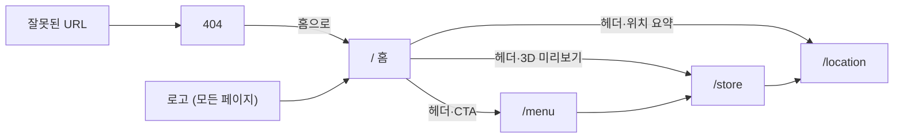

# 03. 사이트맵 & 사용자 흐름

## 1. React Router DOM 라우팅 구조

```tsx
// src/main.tsx
<BrowserRouter>
  <App />            // src/app/App.tsx
</BrowserRouter>

// src/app/router.tsx — AppRoutes
<Routes>
  <Route element={<RootLayout />}>          // Header + <Outlet/> + Footer + ScrollToTop
    <Route index element={<HomePage />} />
    <Route path="menu" element={<MenuPage />} />
    <Route path="store" element={<Suspense fallback={<PageLoader/>}><StorePage /></Suspense>} />  // React.lazy
    <Route path="location" element={<LocationPage />} />
    <Route path="*" element={<NotFoundPage />} />
  </Route>
</Routes>
```

| 경로 | 페이지 | 헤더 표기 | 로딩 방식 | 문서 제목 |
|---|---|---|---|---|
| `/` | HomePage | (로고) | 즉시 | 하루의 잎 — 당신의 하루에, 잎사귀 하나 |
| `/menu` | MenuPage | 메뉴소개 | 즉시 | 메뉴소개 · 하루의 잎 |
| `/menu?category=coffee` | MenuPage (필터) | 메뉴소개 | 즉시 | 동일 |
| `/store` | StorePage | 매장 | `React.lazy` (three 청크) | 매장 · 하루의 잎 |
| `/location` | LocationPage | 오시는 길 | 즉시 | 오시는 길 · 하루의 잎 |
| `*` | NotFoundPage | — | 즉시 | 페이지를 찾을 수 없어요 · 하루의 잎 |

라우트 경로 상수는 `src/app/routes.ts`의 `ROUTES` 객체에서 관리한다. 헤더 내비 항목은 `NAV_ITEMS` 배열로 정의한다.

## 2. 사이트맵

```text
하루의 잎 (/)
├── 히어로 ─ CTA: 메뉴 보기(/menu) · 매장 둘러보기(/store)
├── 브랜드 철학
├── 대표 메뉴 미리보기 ─ 카드 → /menu?category=… , 전체 보기 → /menu
├── 3D 매장 미리보기 ─ 매장 들어가기 → /store
└── 위치 요약 ─ 오시는 길 → /location

메뉴소개 (/menu)
└── 카테고리 필터 [전체 | Coffee | Non-Coffee | Tea | Dessert] → 메뉴 카드 그리드

매장 (/store)
├── 3D 뷰어 (둘러보기 / 실내 탐색 모드)
├── 핫스팟 6개 → 설명 패널
└── 조작 안내 · 시점 초기화

오시는 길 (/location)
├── 주소 + 복사
├── 지도 (OpenStreetMap)
└── 네이버지도 / 카카오맵 길찾기

404 (*)
└── 홈으로 · 메뉴 보기
```

## 3. 페이지 간 이동 흐름



모든 내부 이동은 `<Link>`/`<NavLink>`/`useNavigate`로 처리(전체 새로고침 없음). 외부 지도 링크만 `<a target="_blank">`.

## 4. 메뉴 탐색 시나리오

1. 사용자가 헤더의 **메뉴소개** 클릭 → `/menu`, '메뉴소개' 활성 표시, 스크롤 최상단
2. 기본 '전체' 필터로 23개 카드 노출
3. **Tea** 버튼 클릭 → URL `/menu?category=tea`, 카드 4개, 버튼 `aria-pressed=true`
4. 새로고침 → Tea 필터 유지
5. 뒤로가기 → 이전 필터 상태(전체)로 복귀
6. 카드에서 HOT/ICE 배지로 제공 온도와 판매가 확인

## 5. 3D 매장 탐색 시나리오

1. 홈의 **3D 매장 미리보기** 섹션 또는 헤더의 **매장** 클릭 → `/store`
2. 3D 청크 로딩 중 진행률(%) 표시 → 완료 시 캔버스 페이드인
3. (WebGL 미지원) → 대체 UI: 매장 일러스트 이미지 + 공간 설명 목록
4. 기본 **둘러보기 모드**: 드래그로 회전, 휠/핀치로 줌, 우클릭/두 손가락으로 이동(방 안으로 제한)
5. 핫스팟(빛나는 잎 마커) 클릭 → 카메라가 해당 공간 시점으로 부드럽게 이동 + 설명 패널
6. **실내 탐색 모드** 버튼 → 눈높이(1.6m) 1인칭. 데스크톱: WASD/방향키 이동 + 드래그로 시선. 모바일: 화면 하단 방향 패드 + 드래그로 시선. 벽·카운터·테이블에 막힘(미끄러짐)
7. **시점 초기화** 버튼으로 기본 시점 복귀
8. 하단 CTA "오시는 길 보기" → `/location`
