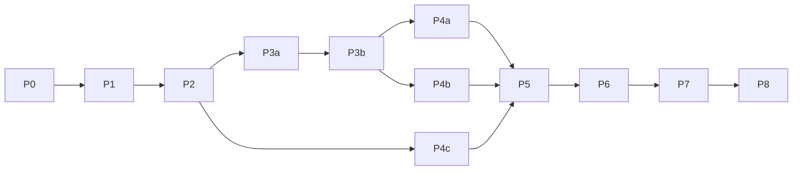

# 12. 개발 로드맵

| 단계 | 내용 | 담당 | 선행 | 병렬 | 완료 조건 |
|---|---|---|---|---|---|
| P0 | 로컬 환경 점검 (Node, Git, Codex, 이미지 도구) | A01 | — | — | 09 §1 기록 |
| P1 | `docs/` 기획 문서 14종 + ADR | A01 | P0 | — | 문서 존재 |
| P2 | 기획 검증 → `docs/initial-planning` 커밋 → `main` 병합 | A01 | P1 | — | 일관성 체크리스트 통과 |
| P3a | `setup/project-foundation`: Vite+React+TS, Router(5경로, lazy store, ScrollToTop, 404 스텁), Tailwind, ESLint, Vitest, Playwright, 데이터(menu/cafe/brand), 타입, 계약 스텁, SPA fallback 설정 | A01 | P2 | — | `verify` 통과, 병합 |
| P3b | `feature/brand-design`: 토큰, 폰트, 공통 컴포넌트, Header/Footer/모바일 내비 | A02 | P3a | — | `verify` 통과, 시각 확인, 병합 |
| P4a | `feature/react-frontend` 홈·메뉴·위치·404 | A03 (Codex) | P3b | ✅ P4b, P4c | 02 HM/MN/LC 충족, `verify` |
| P4b | `feature/threejs-cafe` 3D 매장 + 미리보기 | A04 (Codex) | P3b | ✅ P4a, P4c | 02 ST 충족, `verify` |
| P4c | `feature/visual-assets` 이미지 28종 | A05 (Codex) | P2(경로 확정) | ✅ P4a, P4b | AS-01 |
| P5 | 통합: 리뷰 → P4c → P4a → P4b 순서로 병합, 공통 디자인 정리, 중복 제거 | A01 | P4a~c | — | 병합 후 `verify` + 수동 확인 |
| P6 | `test/qa-optimization`: E2E·단위 보강·성능 점검·결함 수정 | A06 | P5 | — | QA-01~06 |
| P7 | 최종 병합 + 병합 후 전체 테스트·빌드 | A01 | P6 | — | `verify` + `test:e2e` 통과 |
| P8 | README, 에이전트 로그, 최종 보고 | A01 | P7 | — | 산출물 정리 |

## 의존성 그래프

## 단계별 검증

- 각 단계 종료 시 `npm run verify`(P3a 이후)
- P5 이후 내장 브라우저로 375/1440 시각 점검
- P6 이후 `npm run test:e2e`
- 실패 시 해당 단계로 돌아가 수정, 3회 이상 실패하면 미해결 항목으로 기록하고 사용자에게 보고
